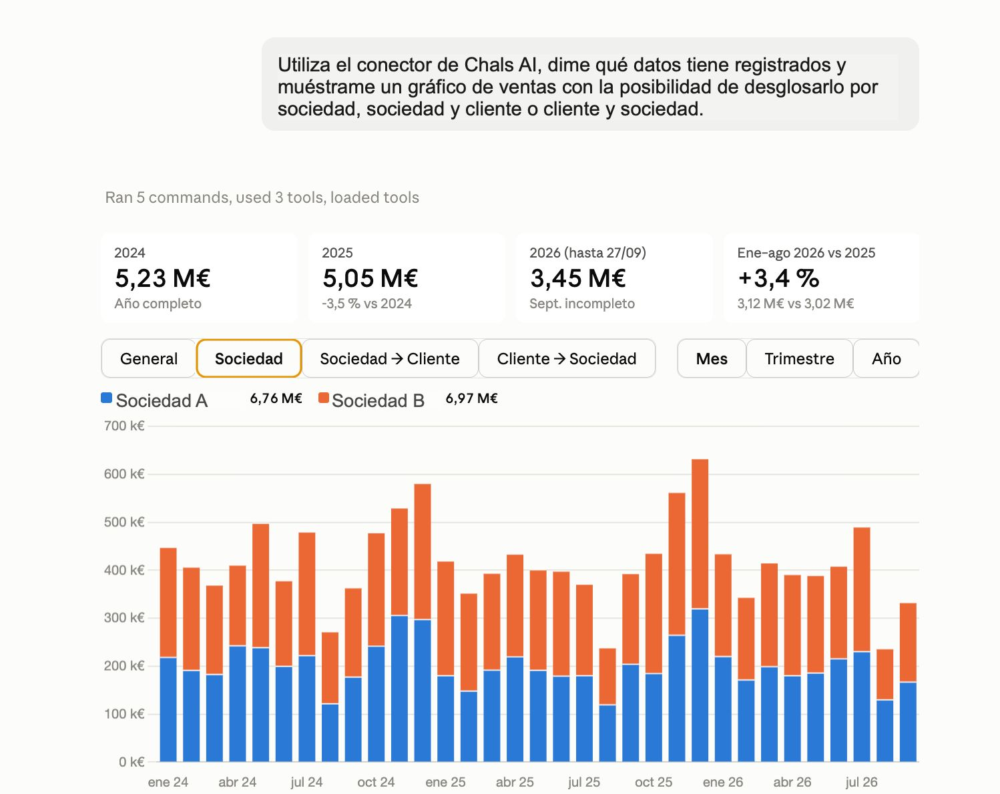
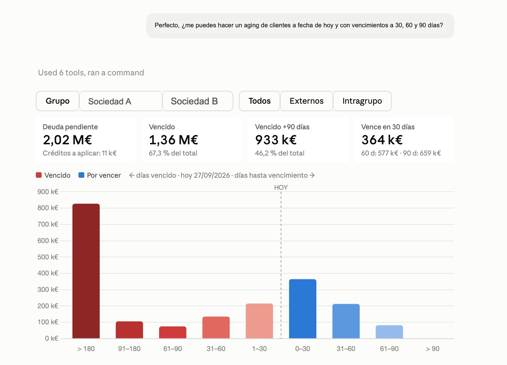
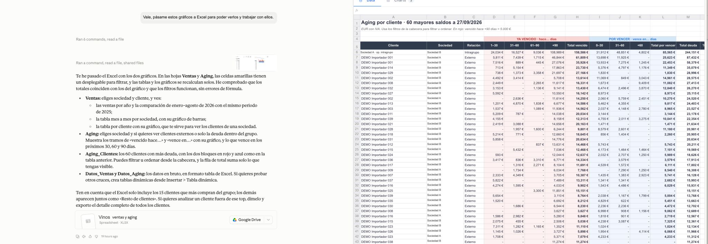
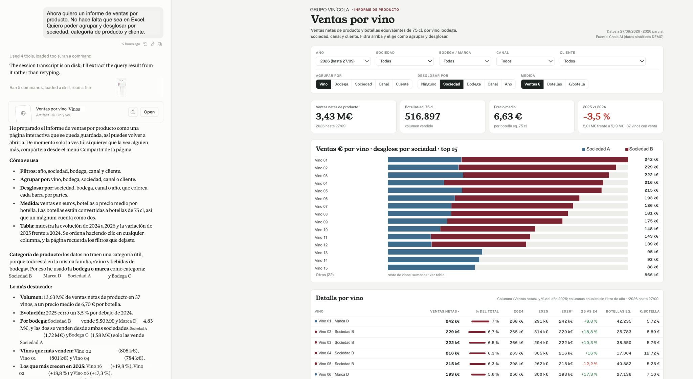
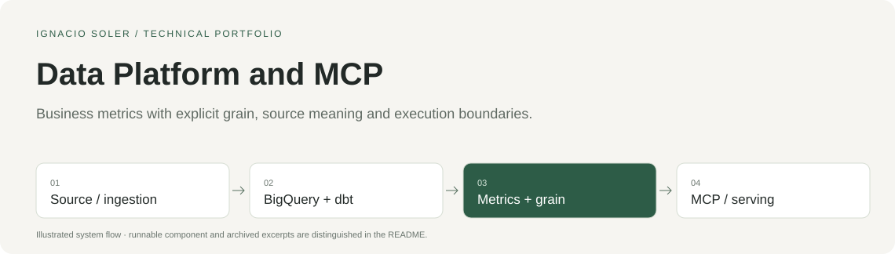

# Data Platform and MCP

Business metrics with explicit grain, source meaning and execution boundaries.

[See the MCP workflow](#see-the-mcp-workflow) · [Run the sample](#run-the-sample) · [Architecture](docs/architecture.md) · [Design decisions](docs/decisions.md) · [Code tour](docs/code-tour.md) · [Español](docs/LEEME.md)

## See the MCP workflow

A wine-business workflow: **ERP → BigQuery → dbt → Chals AI MCP → Claude**. The four screenshots follow one conversation, from sales analysis and receivables aging to Excel and a product report. Published with synthetic data and anonymized names.

| 1. Sales | 2. Receivables aging |
|---|---|
| [](docs/carousel/01-sales.jpg) | [](docs/carousel/02-receivables-aging.jpg) |
| 3. Excel | 4. Product report |
| [](docs/carousel/03-excel.jpg) | [](docs/carousel/04-product-report.jpg) |

[View all four slides at full size](docs/mcp-carousel.md) · [Original LinkedIn post](https://lnkd.in/p/ePyCxKwB) · [Image provenance](docs/carousel/manifest.json).



## The project

An apparently plausible metric can be wrong because its pieces have different grain, filters, source definitions or ownership. An agent must respect those constraints before turning a question into a result.

**My work.** I connected source systems, built and checked curated models, defined base and derived business metrics, and exposed governed analysis through a semantic runtime and MCP. The stack uses BigQuery as the authoritative warehouse and Parquet/DuckDB as derived serving. I led the product and technical construction, using AI-assisted development alongside integration and verification.

**Period.** July 2026–present.

**Current use.** The platform remains active with **two brands**. I also use it through its MCP in **Claude and ChatGPT**, primarily for internal development, exploration and hobby projects.

### Internal use: Chals Channel

**Chals Channel** is one of my side projects. I brought together multiple datasets of LinkedIn profiles and published content, and carried out ingestion, cleaning, normalization, data modeling and quality checks. I use that data through Chals AI’s MCP in Claude and ChatGPT for internal analysis and development.

Usage status reported by the founder on 15 October 2026.

## What you can inspect here

The executable sample runs the original semantic profile-coherence gate against synthetic dictionaries. dbt SQL, publishing, SQL checks and OAuth/MCP behavior are source excerpts. It does not connect to Fivetran, BigQuery or a live MCP.

| Entry | What to look at |
|---|---|
| [profile_coherence.py](source/profile_coherence.py) | Original executable component |
| [demo.py](demo.py) | Synthetic fixtures and 5 checked behaviors |
| [Architecture](docs/architecture.md) | The wider system and the sample boundary |
| [Design decisions](docs/decisions.md) | Tradeoffs with source links |
| [Code tour](docs/code-tour.md) | 18 selected excerpts from the wider construction |
| [Provenance](provenance.json) | Original paths, commits, hashes and documented redactions |

## Run the sample

Requires **Python 3.10+**, with no package installation or account setup.

```sh
git clone https://github.com/nasoler123/data-platform-mcp.git
cd data-platform-mcp
python3 -I demo.py
python3 verify.py
```

The sample runs offline with synthetic data; it rejects socket operations and external subprocesses. `verify.py` checks the result receipt, source hash, local links, instruction parity and credential patterns. These checks cover the published sample rather than the full production system.

Expected observations:

- A coherent daily store-and-ad profile passes.
- Adding an unsupported product grain to its combined metric is rejected.
- Missing references, duplicate concepts and unsupported formula operations are rejected.

[Recorded local results](verification.json).

## Stack in context

Fivetran · BigQuery · dbt · Python · Parquet / DuckDB · MCP · OAuth / PKCE.

The stack describes the wider construction. The executable sample uses Python's standard library; the remaining integrations appear in the code tour.

## Related work

This case belongs to the evolution of **Chals AI**, from document automation and a financial product to agent tooling and managed data infrastructure. The cases overlap; they are not four separate companies.

[Invoice Automation](https://github.com/nasoler123/invoice-automation) · [Financial Modeling SaaS](https://github.com/nasoler123/financial-modeling-saas) · [AI Agent Harness](https://github.com/nasoler123/ai-agent-harness)

[Ignacio Soler](https://github.com/nasoler123) · [LinkedIn](https://www.linkedin.com/in/ignacio-soler-esteban/)
