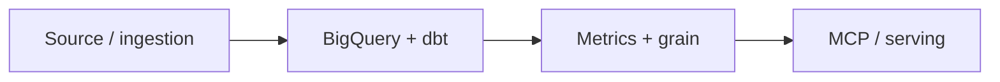

# Architecture

[Project](../README.md) · [Design decisions](decisions.md) · [Code tour](code-tour.md)

## System built

I connected source systems, built and checked curated models, defined base and derived business metrics, and exposed governed analysis through a semantic runtime and MCP. The stack uses BigQuery as the authoritative warehouse and Parquet/DuckDB as derived serving.

## Runnable boundary

The executable sample runs the original semantic profile-coherence gate against synthetic dictionaries. dbt SQL, publishing, SQL checks and OAuth/MCP behavior are source excerpts. It does not connect to Fivetran, BigQuery or a live MCP.

The local route is `synthetic fixture → original component → checked result`. [Read the component](../source/profile_coherence.py) and [run the fixture](../demo.py). The network is blocked before the component is imported.

## External dependencies of the full system

Fivetran · BigQuery · dbt · Python · Parquet / DuckDB · MCP · OAuth / PKCE. The original product connects these components through shared runtime and account context. This repository preserves selected examples and a bounded local demonstration.
